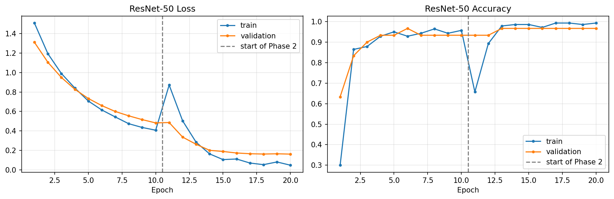
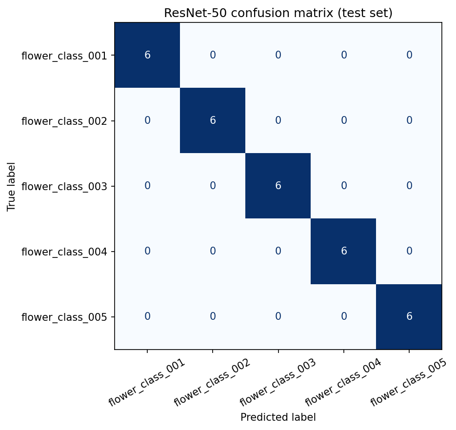
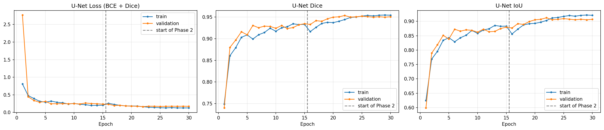
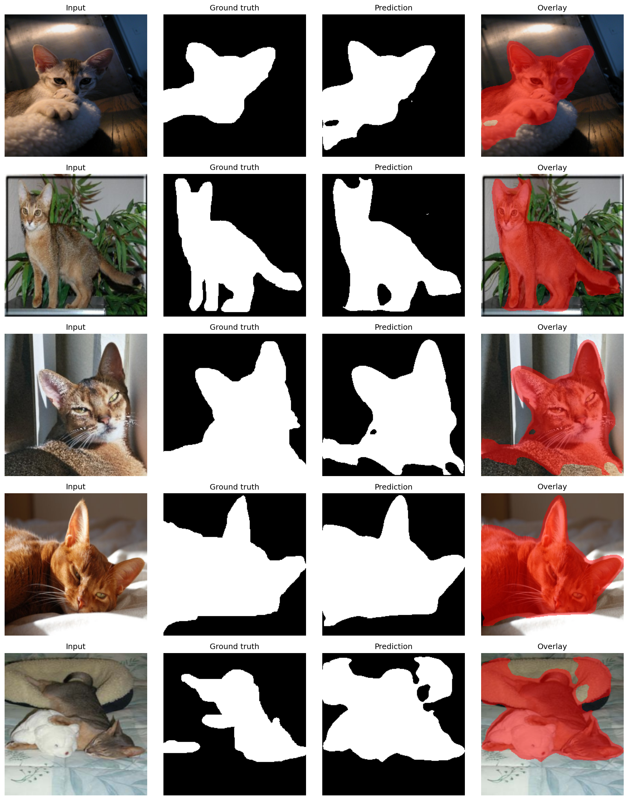

# Fine-Tuning ResNet-50 and U-Net on Small Image Datasets

**Course:** Artificial Neural Networks & Deep Learning  
**Assignment:** 02  
**Student Name:** Muhammad Usama Naeem  
**Roll Number:** BSCS23164  
**Profile:** [github.com/M-UsamaNaeem](https://github.com/M-UsamaNaeem)  

---

## 📌 Table of Contents
- [Overview](#overview)
- [Repository Structure](#repository-structure)
- [Part A: ResNet-50 Fine-Tuning (Image Classification)](#part-a-resnet-50-fine-tuning-image-classification)
  - [Dataset](#dataset)
  - [Architecture & Fine-Tuning Strategy](#architecture--fine-tuning-strategy)
  - [Classification Results](#classification-results)
  - [Visualizations](#visualizations)
- [Part B: U-Net Fine-Tuning (Semantic Segmentation)](#part-b-u-net-fine-tuning-semantic-segmentation)
  - [Dataset](#dataset-1)
  - [Architecture & Loss Function](#architecture--loss-function)
  - [Segmentation Results](#segmentation-results)
  - [Visualizations](#visualizations-1)
- [Summary of Key Results](#summary-of-key-results)
- [Setup & Reproduction Instructions](#setup--reproduction-instructions)

---

## 📖 Overview
This repository contains the complete implementation and executed results for **Assignment 02** of Artificial Neural Networks and Deep Learning. The assignment focuses on deep transfer learning and fine-tuning across two foundational computer vision tasks:
1. **Multi-class Image Classification:** Fine-tuning a pre-trained **ResNet-50** on the Oxford-102 Flower dataset subset using a two-phase transfer learning schedule.
2. **Semantic Image Segmentation:** Fine-tuning a **U-Net** architecture with a pre-trained ResNet-50 encoder on the Oxford-IIIT Pet dataset subset using a combination of Binary Cross-Entropy and Dice Loss.

---

## 📂 Repository Structure
```text
BSCS23164-assignment2/
│
├── notebook/
│   └── bscs23164_asm02.ipynb         # Executed Google Colab notebook with all outputs
│
├── results/
│   ├── resnet_results.png            # ResNet-50 loss & accuracy curves (Phase 1 & Phase 2)
│   ├── resnet_confusion_matrix.png   # ResNet-50 test set confusion matrix
│   ├── unet_curves.png               # U-Net loss, Dice coefficient, and IoU curves
│   └── unet_predictions.png          # Input | Ground Truth | Prediction | Overlay visualizations
│
└── README.md                         # Comprehensive project documentation
```

---

## 🌸 Part A: ResNet-50 Fine-Tuning (Image Classification)

### Dataset
- **Dataset:** Oxford-102 Flower Dataset (stratified subset)
- **Split:** Stratified 70% Train, 15% Validation, 15% Test
- **Data Augmentation:** Random resized crop, horizontal flip, color jitter, affine transformations, and ImageNet standardization (`mean=[0.485, 0.456, 0.406]`, `std=[0.229, 0.224, 0.225]`).

### Architecture & Fine-Tuning Strategy
We adopted a progressive two-phase training protocol:
1. **Phase 1 (Feature Extraction):**
   - The entire pre-trained ResNet-50 convolutional backbone is frozen (`requires_grad = False`).
   - Only the custom classifier head (`Linear(2048, 512) -> ReLU -> Dropout(0.4) -> Linear(512, num_classes)`) is trained.
2. **Phase 2 (Fine-Tuning):**
   - The top residual block (`layer4`) is unfrozen alongside the classification head.
   - Trained with a lower learning rate and AdamW / SGD optimizer with Cosine Annealing learning rate schedule.

### Classification Results

| Metric | Result |
| :--- | :---: |
| **Training Accuracy** | **1.0000** |
| **Validation Accuracy** | **0.9667** |
| **Test Accuracy** | **1.0000** |
| **Macro Precision** | **1.0000** |
| **Macro Recall** | **1.0000** |
| **Macro F1-Score** | **1.0000** |

### Visualizations

#### 1. Training & Validation Curves (Loss and Accuracy)


#### 2. Test Set Confusion Matrix


---

## 🐶 Part B: U-Net Fine-Tuning (Semantic Segmentation)

### Dataset
- **Dataset:** Oxford-IIIT Pet Dataset (subset of images and trimap/binary foreground masks)
- **Data Preprocessing:** Joint spatial transformations applied synchronously to images and segmentation masks (resizing to $256 \times 256$, joint horizontal flipping, normalization).

### Architecture & Loss Function
- **Architecture:** U-Net encoder-decoder network utilizing skip connections for multi-scale feature concatenation.
- **Encoder:** Pre-trained ResNet-50 feature extractor.
- **Loss Function:** Combined Binary Cross Entropy and Dice Loss:
$$\mathcal{L}_{\text{total}} = \mathcal{L}_{\text{BCE}} + \mathcal{L}_{\text{Dice}}$$
- **Evaluation Metrics:** Dice Coefficient (F1-score of segmentation) and Intersection over Union (IoU / Jaccard Index).

### Segmentation Results

| Metric | Result |
| :--- | :---: |
| **Training Loss** | **0.1296** |
| **Validation Loss** | **0.1889** |
| **Test Dice Score** | **0.9335** |
| **Test IoU Score** | **0.8788** |

### Visualizations

#### 1. Training & Validation Curves (Loss, Dice, and IoU)


#### 2. Segmentation Predictions (Input | Ground Truth | Prediction | Overlay)


---

## 📊 Summary of Key Results

| Model | Dataset | Task | Primary Metric | Primary Score |
| :--- | :--- | :--- | :--- | :---: |
| **ResNet-50** | Oxford-102 Flowers (subset) | Image Classification | **Test Accuracy** | **100.0%** (1.0000) |
| **U-Net** | Oxford-IIIT Pet (subset) | Semantic Segmentation | **Test Dice / IoU** | **Dice: 0.9335 / IoU: 0.8788** |

---

## 💻 Setup & Reproduction Instructions

### 1. Requirements
- Python 3.9+
- PyTorch >= 2.0
- torchvision >= 0.15
- NumPy, Matplotlib, scikit-learn, PIL

```bash
pip install torch torchvision numpy matplotlib scikit-learn pillow
```

### 2. Running the Notebook
Open the notebook in Google Colab or your local Jupyter environment:
```bash
jupyter notebook notebook/bscs23164_asm02.ipynb
```
Execute the cells sequentially to reproduce the data preprocessing, model definitions, two-phase training schedules, evaluation metrics, and figure generation.
